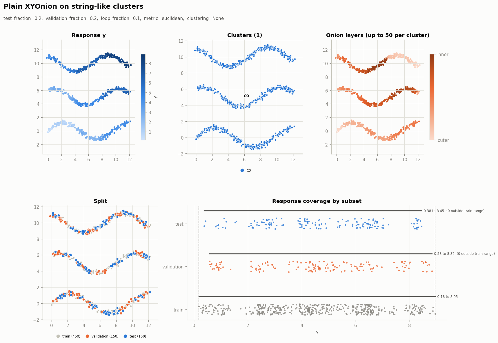
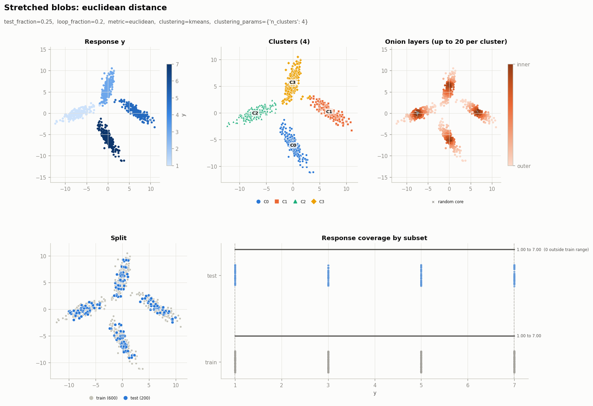
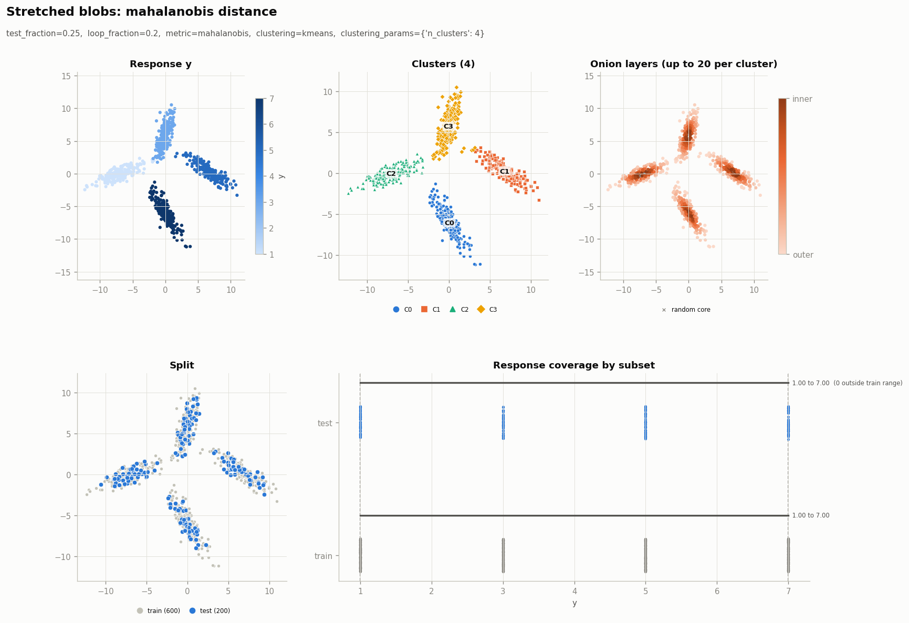
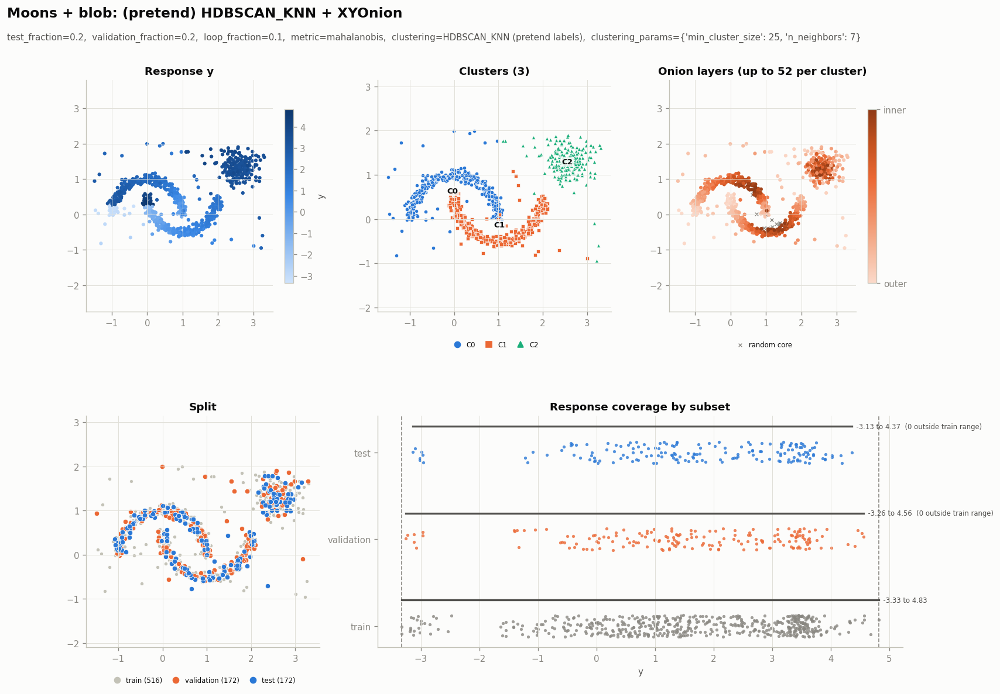
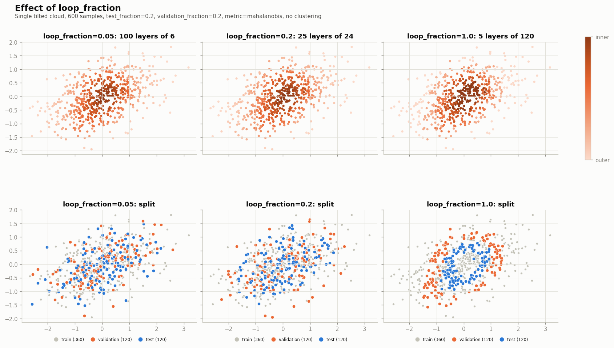

# clustered_xyonion

A Python implementation of the **XYOnion** train/validation/test
(calibration/validation) splitting method, with an optional **clustered**
variant for data whose clusters are not convex (e.g. long, string-like
clusters).

XYOnion (Ezenarro, *Anal. Chim. Acta* 1364 (2025) 344229,
[doi:10.1016/j.aca.2025.344229](https://doi.org/10.1016/j.aca.2025.344229))
combines SPXY-style joint X–y distances with Onion-style layered selection:
samples are peeled off in shells from the outside in, the outermost shell goes
to training (so validation and test are never extrapolated), and later layers
are shared out between the subsets so every subset spans the whole data space.

Standard XYOnion assumes the data set is roughly convex. The clustered variant
first gives every sample a hard cluster label (kmeans or HDBSCAN + KNN), runs
XYOnion on each cluster on its own, and recombines the per-cluster splits.

## Install

Target environment: Python 3.9, numpy 1.21.5, scipy 1.7.3, scikit-learn 1.0.2
(pinned in `pyproject.toml` and `uv.lock`). On Windows with Smart App Control
on, build and run it inside WSL.

```bash
uv sync
```

## Usage

```python
from clustered_xyonion import (
    XYOnionSplit, xyonion_train_test_split, xyonion_train_val_test_split)

# Train/test, like sklearn.model_selection.train_test_split (X and y required)
X_train, X_test, y_train, y_test = xyonion_train_test_split(
    X, y,
    test_fraction=0.25,
    loop_fraction=0.1,
    metric="mahalanobis",          # or "euclidean"
    clustering="kmeans",           # or "hdbscan", None, or your own clusterer
    clustering_params={"n_clusters": 5},
    random_state=0,
)

# Train/validation/test
X_train, X_val, X_test, y_train, y_val, y_test = xyonion_train_val_test_split(
    X, y, test_fraction=0.2, validation_fraction=0.2, random_state=0)

# Extra arrays are split the same way, as in train_test_split
X_train, X_test, y_train, y_test, w_train, w_test = xyonion_train_test_split(
    X, y, sample_weight, random_state=0)

# As a splitter / cv object (train/test only: one split, like ShuffleSplit)
cv = XYOnionSplit(clustering="kmeans", clustering_params={"n_clusters": 5},
                  random_state=0)
train_idx, test_idx = next(cv.split(X, y))

from sklearn.model_selection import GridSearchCV
GridSearchCV(model, grid, cv=cv).fit(X, y)

# Diagnostics: indices of each subset, cluster labels, layer of each sample
info = XYOnionSplit(test_fraction=0.2, validation_fraction=0.2).split_info(X, y)
info.train_indices, info.validation_indices, info.test_indices
info.subset            # 0 = train, 1 = validation, 2 = test
info.cluster_labels, info.layer, info.clusterer
```

### Parameters

| Parameter | Default | Meaning |
|---|---|---|
| `test_fraction` | `0.25` | Fraction of samples in the test set, in (0, 1). |
| `validation_fraction` | `0.0` | Fraction in the validation set, in [0, 1); 0 = no validation set. `test_fraction + validation_fraction` must be below 1. |
| `loop_fraction` | `0.1` | Layer size is `max(1, round(loop_fraction * f * n_k))` for a cluster of `n_k` samples, where `f` is the smaller of the non-zero held-out fractions. |
| `metric` | `"euclidean"` | `"euclidean"` or `"mahalanobis"`, used within each cluster. |
| `clustering` | `None` | `None`, `"kmeans"`, `"hdbscan"`, or any estimator with `fit_predict`. |
| `clustering_params` | `None` | Dict of keyword arguments for the clustering algorithm. |
| `random_state` | `None` | Seeds the random core split and, unless set explicitly, the clusterer's `random_state`. |

`xyonion_train_val_test_split` defaults to `test_fraction=0.2`,
`validation_fraction=0.2`. `XYOnionSplit.split` (the cv interface) needs
`validation_fraction=0`; use `split_info` or `xyonion_train_val_test_split`
for three subsets.

`y` is required and must be a single numeric response (shape `(n,)` or
`(n, 1)`); a missing, empty or multi-column `y` raises `ValueError`.

Clustering runs on `X` only, so scale `X` beforehand if its features have
different units.

### Clustering options

- `"kmeans"`: `sklearn.cluster.KMeans`; e.g.
  `clustering_params={"n_clusters": 5}`.
- `"hdbscan"`: `HDBSCAN_KNN`, which runs HDBSCAN and then assigns HDBSCAN's
  noise points to clusters with a KNN vote, so every sample gets a hard label.
  Parameters: `min_cluster_size`, `min_samples`, `cluster_selection_epsilon`,
  `metric` and `n_neighbors` (neighbours used in the KNN vote), e.g.
  `clustering_params={"min_cluster_size": 20, "n_neighbors": 5}`.
  **Currently a placeholder:** it raises `NotImplementedError` when fitted.
- If a clusterer does return noise labels (−1), those points are split
  together as one extra group.

## Examples

`examples/` has scripts that plot splits of 2D/3D clustered data with fake
responses. Each saves a figure to `examples/output/`; add `--show` to open it
in a window too. They need matplotlib (the `examples` dependency group).

| Script | Shows |
|---|---|
| `01_strings_plain_vs_kmeans.py` | Why cluster first: plain vs kmeans + XYOnion on string-like clusters |
| `02_blobs_euclidean_vs_mahalanobis.py` | Euclidean vs Mahalanobis layers on stretched blobs; train/test vs train/validation/test |
| `03_moons_hdbscan_knn.py` | HDBSCAN_KNN on moons + blob + noise (pretend labels until it's implemented) |
| `04_loop_fraction.py` | Thin vs thick layers as `loop_fraction` changes |
| `05_helices_3d_kmeans.py` | kmeans + XYOnion on 3D helices |

```bash
uv run --group examples python examples/01_strings_plain_vs_kmeans.py
```

Each figure shows the response, the clusters, the onion-layer depth within
each cluster, the split, and the response range of each subset (dashed lines
mark the train range; values outside it are counted).

### Why cluster first

Plain XYOnion treats the three strings as one cloud, so its layers cut across
them:



With kmeans first, each piece of each string gets its own onion. Note the one
validation sample just above the train range: with thin layers the outermost
layer doesn't always contain a cluster's y extremes, so the no-extrapolation
property isn't strict.


### Euclidean vs Mahalanobis

The response is constant within each blob here, so the layers show the X
metric alone. Euclidean layers are round, peeling each blob's long ends first;
Mahalanobis layers follow each blob's shape.






### HDBSCAN_KNN (pretend labels)



### loop_fraction



### 3D


## Assumptions

The paper leaves some details open, and the author's Matlab code is available
only on request. Until it is available, the implementation uses these rules,
all in `xyonion_group_split` in `src/clustered_xyonion/_core.py`:

1. **Distance:** `d(p, q) = d_x(p, q) / max d_x + d_y(p, q) / max d_y`, with the
   maxima being the largest pairwise distances in the cluster. Mahalanobis uses
   the pseudoinverse of the cluster's X covariance and `var(y)`.
2. **Layer membership:** each layer takes the remaining samples furthest from
   the centroid by that combined distance. For Euclidean, the centroid is
   recomputed from the remaining samples at each layer; for Mahalanobis it is
   computed once from the whole cluster.
3. **Layer size:** `round(loop_fraction * f * n_k)`, `f` being the smaller
   non-zero held-out fraction, or 1 sample per layer when that rounds to 0
   (small clusters).
4. **Layer assignment:** the first layer goes to train. Each later layer goes
   to whichever subset is furthest below its target share, without exceeding
   any subset's exact count (ties go to train, then validation). With two
   subsets this is the same as keeping the running test ratio closest to
   `test_fraction`.
5. **Final split:** samples left over when a full layer no longer fits are
   split at random so each subset's count in the cluster is exact.
6. **Rounding:** the overall counts are `round(test_fraction * n_samples)` and
   `round(validation_fraction * n_samples)` (halves round up), shared between
   clusters by the largest-remainder method so the totals are exact and no
   cluster's validation + test exceeds its size.

## Development

```bash
uv run python -m pytest
```

`tests/test_core.py` needs only numpy; `tests/test_xyonion.py` needs
scikit-learn and pandas.
