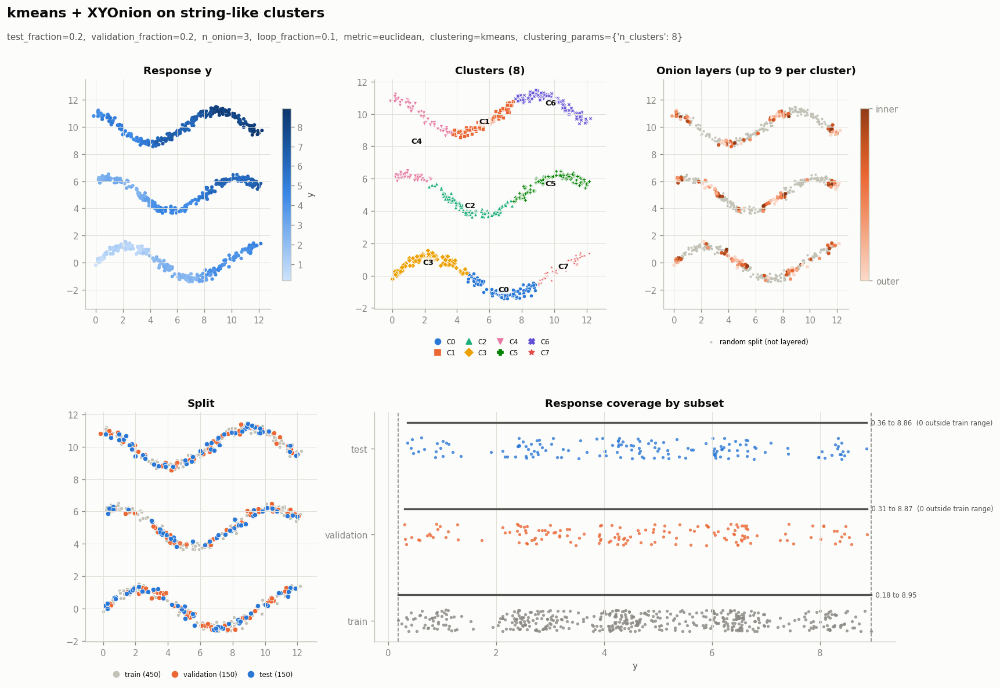
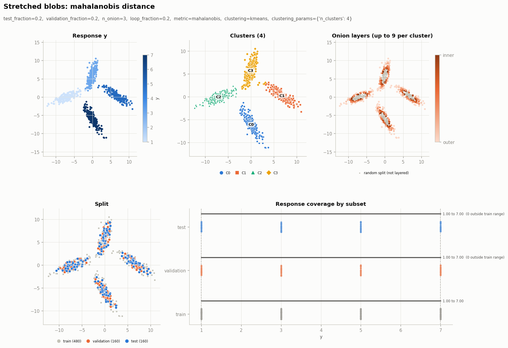
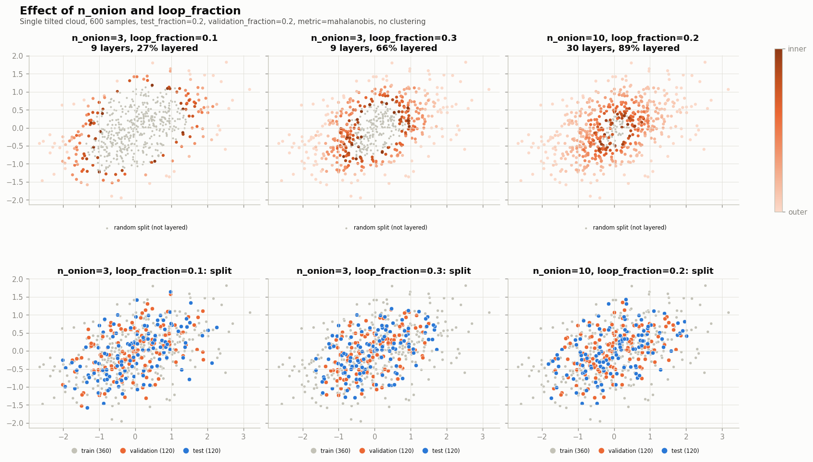
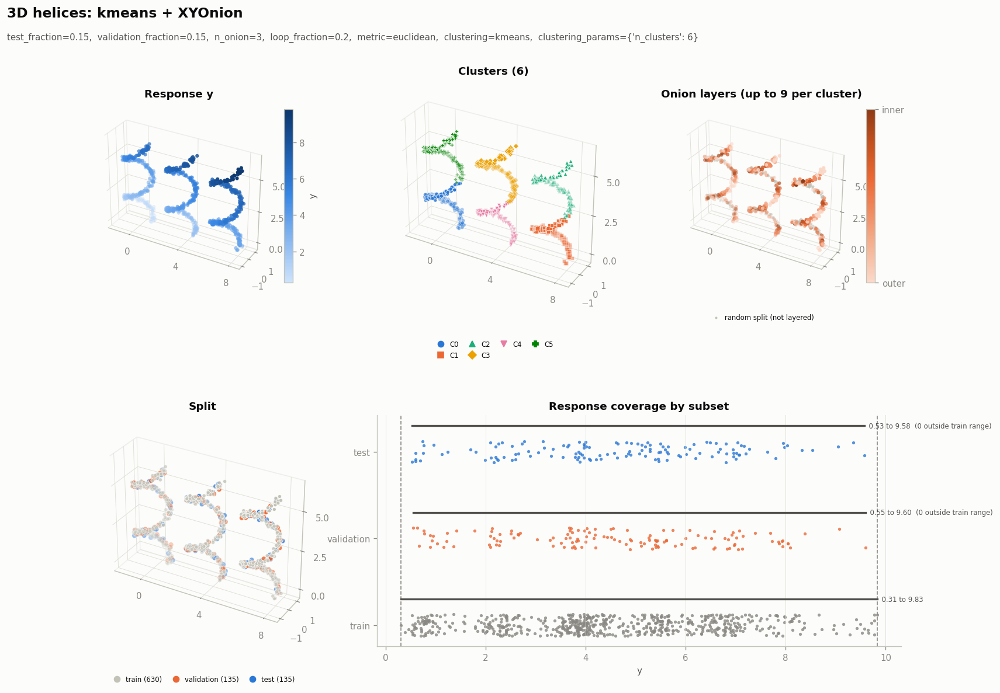

# clustered_xyonion

A Python implementation of the **XYOnion** train/validation/test
(calibration/validation) splitting method, with an optional **clustered**
variant for data whose clusters are not convex (e.g. long, string-like
clusters).

XYOnion (Ezenarro, *Anal. Chim. Acta* 1364 (2025) 344229,
[doi:10.1016/j.aca.2025.344229](https://doi.org/10.1016/j.aca.2025.344229))
combines SPXY-style joint X–y distances with Onion-style layered selection:
in a few rounds, spread-out samples are peeled off the outside of the data and
given in turn to train, test and validation (train first, so validation and
test are not extrapolated); the remaining core is split at random. This
package follows the author's reference MATLAB implementation
([JokinEzenarro/XYOnion](https://github.com/JokinEzenarro/XYOnion)), with the
extensions listed under [How it works](#how-it-works).

Standard XYOnion assumes the data set is roughly convex. The clustered variant
first gives every sample a hard cluster label (kmeans or HDBSCAN + KNN), runs
XYOnion on each cluster on its own, and recombines the per-cluster splits.

## Install

Target environment: Python 3.9, numpy 1.21.5, scipy 1.7.3, scikit-learn 1.0.2
(pinned in `pyproject.toml` and `uv.lock`). On Windows with Smart App Control
on, build and run it inside WSL.

```bash
uv sync
```

## Usage

```python
from clustered_xyonion import (
    XYOnionSplit, xyonion_train_test_split, xyonion_train_val_test_split)

# Train/test, like sklearn.model_selection.train_test_split (X and y required)
X_train, X_test, y_train, y_test = xyonion_train_test_split(
    X, y,
    test_fraction=0.25,
    n_onion=3,
    loop_fraction=0.1,
    metric="mahalanobis",          # or "euclidean"
    clustering="kmeans",           # or "hdbscan", None, or your own clusterer
    clustering_params={"n_clusters": 5},
    random_state=0,
)

# Train/validation/test
X_train, X_val, X_test, y_train, y_val, y_test = xyonion_train_val_test_split(
    X, y, test_fraction=0.2, validation_fraction=0.2, random_state=0)

# Extra arrays are split the same way, as in train_test_split
X_train, X_test, y_train, y_test, w_train, w_test = xyonion_train_test_split(
    X, y, sample_weight, random_state=0)

# As a splitter / cv object (train/test only: one split, like ShuffleSplit)
cv = XYOnionSplit(clustering="kmeans", clustering_params={"n_clusters": 5},
                  random_state=0)
train_idx, test_idx = next(cv.split(X, y))

from sklearn.model_selection import GridSearchCV
GridSearchCV(model, grid, cv=cv).fit(X, y)

# Diagnostics: indices of each subset, cluster labels, layer of each sample
info = XYOnionSplit(test_fraction=0.2, validation_fraction=0.2).split_info(X, y)
info.train_indices, info.validation_indices, info.test_indices
info.subset            # 0 = train, 1 = validation, 2 = test
info.cluster_labels, info.layer, info.clusterer
```

### Parameters

| Parameter | Default | Meaning |
|---|---|---|
| `test_fraction` | `0.25` | Fraction of samples in the test set, in (0, 1). |
| `validation_fraction` | `0.0` | Fraction in the validation set, in [0, 1); 0 = no validation set. `test_fraction + validation_fraction` must be below 1. |
| `n_onion` | `3` | Number of onion rounds (`nonion` in the reference). Each round peels one layer for train, then test, then validation. |
| `loop_fraction` | `0.1` | Fraction of the remaining samples peeled per round (fixed at 0.1 in the reference). A subset's layer holds `round(loop_fraction * m0 * f)` samples, `m0` being the cluster's samples still unassigned at the start of the round and `f` that subset's fraction. |
| `metric` | `"euclidean"` | `"euclidean"` or `"mahalanobis"` for X, within each cluster. |
| `clustering` | `None` | `None`, `"kmeans"`, `"hdbscan"`, or any estimator with `fit_predict`. |
| `clustering_params` | `None` | Dict of keyword arguments for the clustering algorithm. |
| `random_state` | `None` | Seeds the random core split and, unless set explicitly, the clusterer's `random_state`. |

`xyonion_train_val_test_split` defaults to `test_fraction=0.2`,
`validation_fraction=0.2`. `XYOnionSplit.split` (the cv interface) needs
`validation_fraction=0`; use `split_info` or `xyonion_train_val_test_split`
for three subsets.

`y` is required and must be a single numeric response (shape `(n,)` or
`(n, 1)`); a missing, empty or multi-column `y` raises `ValueError`.

Clustering runs on `X` only, so scale `X` beforehand if its features have
different units.

### Clustering options

- `"kmeans"`: `sklearn.cluster.KMeans`; e.g.
  `clustering_params={"n_clusters": 5}`.
- `"hdbscan"`: `HDBSCAN_KNN`, which runs HDBSCAN and then assigns HDBSCAN's
  noise points to clusters with a KNN vote, so every sample gets a hard label.
  Parameters: `min_cluster_size`, `min_samples`, `cluster_selection_epsilon`,
  `metric` and `n_neighbors` (neighbours used in the KNN vote), e.g.
  `clustering_params={"min_cluster_size": 20, "n_neighbors": 5}`.
  **Currently a placeholder:** it raises `NotImplementedError` when fitted.
- If a clusterer does return noise labels (−1), those points are split
  together as one extra group.

## Examples

`examples/` has scripts that plot splits of 2D/3D clustered data with fake
responses. Each saves a figure to `examples/output/`; add `--show` to open it
in a window too. They need matplotlib (the `examples` dependency group).

| Script | Shows |
|---|---|
| `01_strings_plain_vs_kmeans.py` | Why cluster first: plain vs kmeans + XYOnion on string-like clusters |
| `02_blobs_euclidean_vs_mahalanobis.py` | Euclidean vs Mahalanobis layers on stretched blobs; train/test vs train/validation/test |
| `03_moons_hdbscan_knn.py` | HDBSCAN_KNN on moons + blob + noise (pretend labels until it's implemented) |
| `04_n_onion_and_loop_fraction.py` | How much of the data is layered as `n_onion` and `loop_fraction` change |
| `05_helices_3d_kmeans.py` | kmeans + XYOnion on 3D helices |

```bash
uv run --group examples python examples/01_strings_plain_vs_kmeans.py
```

Each figure shows the response, the clusters, the onion layers within each
cluster (grey dots are the unlayered core, split at random), the split, and
the response range of each subset (dashed lines mark the train range; values
outside it are counted).

### Why cluster first

Plain XYOnion treats the three strings as one cloud, so its layers come from
the outside of that cloud (the string ends and the outer strings) and the
middle string is hardly layered:


With kmeans first, each piece of each string gets its own onion, so every
piece's extremes go to train:



### Euclidean vs Mahalanobis

The response is constant within each blob here, so the layers show the X
metric alone. With Euclidean distance the layers come mostly from each blob's
long ends and the unlayered core is rounder; with Mahalanobis distance they
form an even rim all round and the core keeps the blob's shape.




### HDBSCAN_KNN (pretend labels)


### n_onion and loop_fraction

With the reference defaults (3 rounds of 10%) about 27% of the data is
layered; more rounds or a larger `loop_fraction` layer more of it.



### 3D



## How it works

Within each cluster (or the whole data set without clustering), following the
reference implementation `XYonion.m`; the code is in
`src/clustered_xyonion/_core.py`:

1. **Rounds and layer sizes:** `n_onion` rounds. At the start of each round,
   with `m0` samples still unassigned, the round peels a train layer of
   `round(loop_fraction * m0 * train_fraction)` samples, then a test layer of
   `round(loop_fraction * m0 * test_fraction)`, then (if requested) a
   validation layer of `round(loop_fraction * m0 * validation_fraction)`.
   Train always goes first, so the outermost samples are in train.
2. **Layer selection (DISTSLCT):** each layer is picked by DISTSLCT on the
   samples still unassigned, with X and y re-centred on those samples. The
   first picks (as many as X has columns) are the samples furthest from the
   centre, each new one orthogonal to the earlier ones; after that, each pick
   is the sample with the largest summed distance to everything picked so
   far. This spreads the layer around the outside of the data.
3. **Balancing X and y:** at every pick the X distances and y distances are
   each divided by their maximum over the candidates, then added, so X and y
   carry equal weight (and y's units don't matter).
4. **Mahalanobis:** each cluster is whitened with its own covariance before
   step 1, so Euclidean distance on the result is the cluster's Mahalanobis
   distance.
5. **Random core:** the samples left after the last round are split at
   random.

Where this differs from `XYonion.m`, deliberately:

- **Clustering** and a **validation** set (the reference only has
  calibration/validation, i.e. train/test).
- **Exact counts:** the overall counts are `round(test_fraction * n_samples)`
  and `round(validation_fraction * n_samples)` (halves round up), shared
  between clusters by the largest-remainder method; no layer may overshoot a
  subset's count and the random core makes up the rest exactly. The reference
  rounds per layer and then uses `ceil`, so its counts are approximate.
- `loop_fraction` is a parameter (fixed at 0.1 in the reference), and
  `random_state` controls the random core.
- **Mahalanobis** uses the pseudoinverse (singular covariances work) and is
  computed per cluster.
- **Robustness:** DISTSLCT never picks the same sample twice, and a block with
  no spread (e.g. constant y) contributes nothing instead of dividing by zero.

## Development

```bash
uv run python -m pytest
```

`tests/test_core.py` needs only numpy; `tests/test_xyonion.py` needs
scikit-learn and pandas.

## Citation and license

XYOnion is the method of Ezenarro (2025). If you use this package, please
cite the original article:

> Ezenarro, J. (2025). *XYOnion: a layer-based method for splitting datasets
> into calibration and validation subsets*. Analytica Chimica Acta, 1364,
> 344229. https://doi.org/10.1016/j.aca.2025.344229

The author's reference MATLAB implementation is at
<https://github.com/JokinEzenarro/XYOnion>.

This package is released under the MIT License (see `LICENSE.txt`), which
keeps the reference implementation's copyright and permission notice. The
article in `papers/xyonion.pdf` is not covered by the MIT License; it remains
under its published CC BY-NC-ND 4.0 license.
